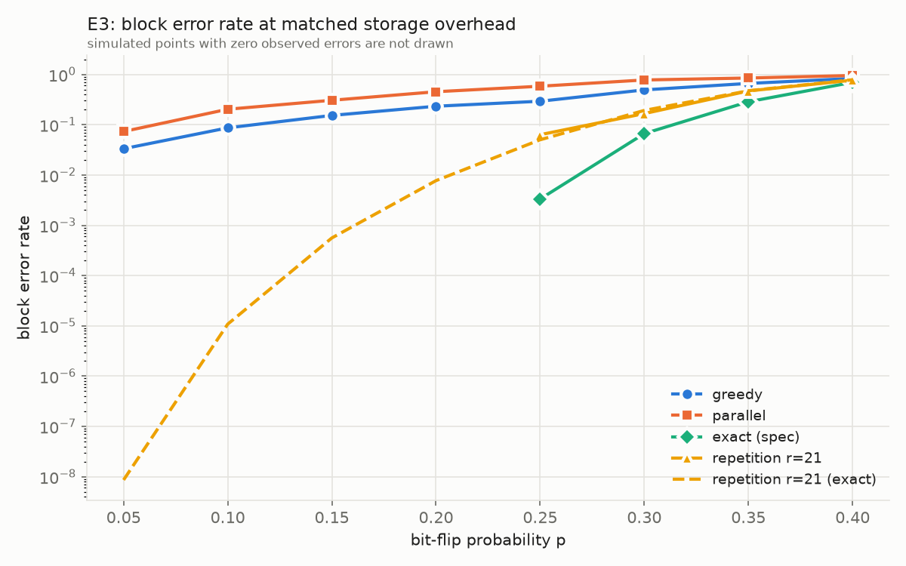

# Fuzzy Hashing ECC

A proof of concept for **error correction by consensus against fuzzy hashes**. Each byte of data is stored unchanged, next to $J$ (default 20) locality-sensitive hashes of it: the signs of random ±1 projections, as in SimHash. To repair a corrupted byte, the decoder picks the byte whose data and hashes agree best with what was read. Each hash acts as a *juror* that supports the bytes it recognises.

[`docs/summary.pdf`](docs/summary.pdf) has the definition, results and proofs.

## Usage

```sh
uv sync --extra plot     # numpy, plus matplotlib for the optional plot

# Protect a file, damage it, recover it
uv run fuzzy-hashing-ecc encode photo.jpg photo.ecc               # 21× larger
uv run fuzzy-hashing-ecc noise  photo.ecc photo.bad --p 0.05      # flip 5% of all bits
uv run fuzzy-hashing-ecc decode photo.bad photo.out.jpg
cmp photo.jpg photo.out.jpg && echo "recovered exactly"
```

There are only two settings, and `encode` and `decode` must use the same values:

| Flag | Default | Meaning |
|---|---|---|
| `--jurors` | 20 | signatures per byte; storage cost is (jurors + 1)× |
| `--key` | 0 | seed for the secret matrices |

```sh
uv run fuzzy-hashing-ecc demo --toy-only     # one byte, one flipped bit, every juror's vote
uv run fuzzy-hashing-ecc experiments --plot results/e3_bler.png   # all results, ~15 s
uv run pytest && uv run mypy                 # tests and strict type check
```

From Python:

```python
from fuzzy_hashing_ecc import ConsensusCode, encode_bytes, decode_bytes

code = ConsensusCode(jurors=20, key=0)
blob = encode_bytes(b"hello", code)
assert decode_bytes(blob, code) == b"hello"
```

| Module | Contents |
|---|---|
| `scheme.py` | `ConsensusCode`: the chosen design, with fast exact decoding of whole files |
| `stream.py`, `channel.py` | File framing with a protected length header; bit-flip noise models |
| `baselines.py` | Repetition code with the same storage cost, for comparison |
| `research.py`, `projections.py`, `signatures.py` | The alternatives compared before fixing the design (matrix families, threshold rules, decoders) |
| `experiments.py`, `plotting.py` | The experiments behind the results |

## Results

With 20 jurors (21× storage), the scheme beats plain repetition: minimum distance 27 vs 21, and 6.7% vs 19% of bytes lost at a 30% bit-flip rate. But it falls far short of the optimal linear code of the same size, which has minimum distance 82 ([codetables.de](https://codetables.de/)). For *any* choice of ±1 matrices the minimum distance is at most 44. With only 2 jurors (3× storage), it loses even to storing three copies (TMR).

Proofs: [`docs/summary.pdf`](docs/summary.pdf). Full experiment output: [`results/experiments.txt`](results/experiments.txt).



## Open directions

- **Noise-tolerant matching instead of correction.** Fuzzy hashes are weak as an error-correcting code but well suited to recognising noisy inputs, as in biometric templates or approximate authentication.
- **Security of the key.** How hard is it to recover the secret matrices from observed signatures, especially if noise is added deliberately? This connects to lattice-based cryptography.
- **Choosing good keys.** The minimum distance varies with the key. Is there a fast way to find good keys, or a structured family of matrices with a guaranteed larger distance?
